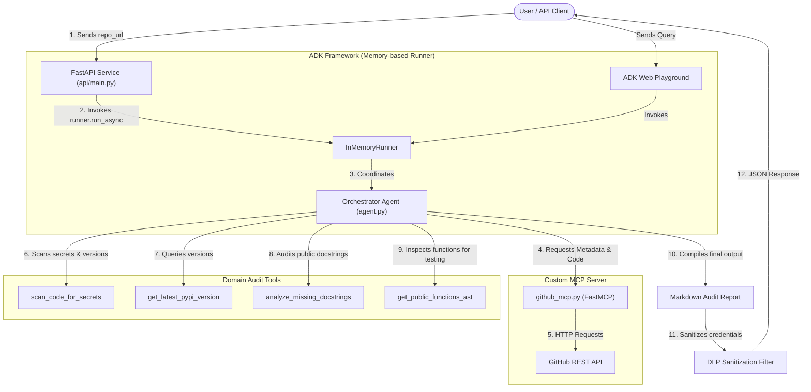

# Repo Auditor

Repo Auditor is an automated, multi-agent code analysis system built with the **Google Agent Development Kit (ADK)** and **Gemini 2.5 Pro**. It connects directly to the GitHub REST API via a custom **Model Context Protocol (MCP)** server to analyze repository source code and dependencies in seconds. 

It generates a single, consolidated Markdown audit report covering:
1. **Repository Metadata**: Basic stats (stars, forks, description, primary language).
2. **Security Audit**: Exposed secrets/credentials (AWS keys, GitHub tokens, passwords) using advanced regex patterns and checks for outdated dependencies against the PyPI registry.
3. **Documentation Coverage**: Scans for classes and functions lacking docstrings or explanatory comments and proposes Google/Sphinx-style inline documentation suggestions ready to copy-paste.
4. **Unit Test Coverage**: Detects public functions missing test cases and drafts comprehensive `pytest` skeleton test suites (including Happy Path and Edge Cases).

---

## System Architecture



The system employs a strict **context-limiting window** to remain cost-efficient and avoid token overflows:
*   It only scans Python files located in the root or main source directories (ignoring `tests/`, `examples/`, `docs/` and hidden folders recursively).
*   It limits execution to a maximum of 5 Python files, prioritizing core library files.
*   It reads `requirements.txt` to parse and check dependency versions against the official PyPI API.

---

## Local Setup & Installation

### 1. Prerequisites
Ensure you have the following installed on your machine:
*   Python 3.10 or 3.11
*   `pip` (Python package manager)
*   A GitHub Personal Access Token (for fetching repo contents without severe rate limiting)
*   A Gemini API Key (from Google AI Studio or Google Cloud Vertex AI)

### 2. Clone the Repository
```bash
git clone <repository-url>
cd repo-auditor-agents
```

### 3. Create a Virtual Environment and Install Dependencies
Initialize a virtual environment and install the required modules listed in `requirements.txt`:
```bash
python3 -m venv venv
source venv/bin/activate
pip install -r requirements.txt
```

### 4. Configure Environment Variables
Create a `.env` file in the **root** of the project and in the **agent's directory** (`agents/orchestrator/.env`):

```env
GOOGLE_API_KEY=your_gemini_api_key_here
GITHUB_TOKEN=your_github_personal_access_token_here
```

*Note: The `GITHUB_TOKEN` is required to communicate with the GitHub API. The `GOOGLE_API_KEY` is utilized locally to execute the Gemini model.*

---

## How to Run Locally

You can run the Repo Auditor locally in two ways: using the ADK Web UI (playground) or through the FastAPI Web Service.

### Option A: ADK Interactive Web UI
Launch the built-in development playground to interact with the orchestrator agent visually:
```bash
PYTHONPATH=. venv/bin/adk web agents/orchestrator
```
Once started, open your browser and navigate to the local server (usually `http://127.0.0.1:8000`). Select **"New Session"** and submit a prompt like:
> `Analyze this repository: https://github.com/pallets/click`

### Option B: FastAPI Web Service
For API integration, run the FastAPI server using `uvicorn`:
```bash
PYTHONPATH=. venv/bin/uvicorn api.main:app --reload --port 8080
```
This boots the API server on port `8080` with the following endpoints:
*   `GET /health`: Basic health-check endpoint (`{"status": "ok"}`).
*   `POST /audit`: Initiates a repository audit.

#### Testing the API with curl:
Send a request containing the target GitHub URL:
```bash
curl -X POST http://localhost:8080/audit \
     -H 'Content-Type: application/json' \
     -d '{"repo_url": "https://github.com/octocat/Hello-World"}'
```

---

## API Security Measures

The FastAPI wrapper in [api/main.py](api/main.py) incorporates the following security controls:

*   **Measure 1: GitHub URL Validation (SSRF Protection)**
    *   **File:** [api/main.py](api/main.py#L90-L97) (Lines 90-97)
    *   **Explanation:** Validates that inputs strictly start with `https://github.com/` to block local or malicious server-side request forgery attempts.
*   **Measure 2: IP-Based Rate Limiting (DoS Protection)**
    *   **File:** [api/main.py](api/main.py#L28-L42) (Lines 28-42) and [api/main.py](api/main.py#L77-L84) (Lines 77-84)
    *   **Explanation:** Restricts abusive request bursts to a maximum of 5 requests per minute per client IP address.
*   **Measure 3: Secret Sanitization and DLP (Data Leak Prevention)**
    *   **File:** [api/main.py](api/main.py#L45-L60) (Lines 45-60) and [api/main.py](api/main.py#L145-L146) (Lines 145-146)
    *   **Explanation:** Redacts the GitHub access token and Gemini API key from the output in case the model accidentally exposes them.

---

## Deployment to Google Cloud (Vertex AI Agent Runtime)

To host your agent on Google Cloud's managed runtime so anyone can test it via a public playground:

1.  **Install the Google Cloud CLI (`gcloud`)** and login to your Google account:
    ```bash
    gcloud auth application-default login
    ```
2.  **Set your Google Cloud Project ID**:
    ```bash
    gcloud config set project YOUR_PROJECT_ID
    ```
3.  **Execute the ADK Deployment Command**:
    ```bash
    PYTHONPATH=. venv/bin/adk deploy agent_engine --project=YOUR_PROJECT_ID --region=YOUR_REGION agents/orchestrator
    ```

*Note: The orchestrator's code contains a production guard ([agent.py](agents/orchestrator/agent.py#L8-L14)) that automatically strips the local API key when running in Vertex AI, forcing the agent to use Google Cloud's **Application Default Credentials (ADC)** for secure, role-based backend calls.*